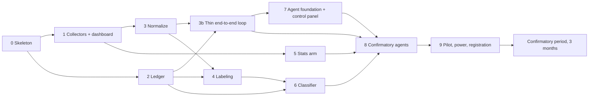

# Build plan

Nov 3, 2026 · @Berg

This is the order to build the system in, what each step depends on, a rough effort for each, and a checklist to tick as you go. The tools, the details of each step, the testing strategy and the UIs are in [stack-and-build-guide.md](stack-and-build-guide.md). This file is the schedule.

## The rule behind the order

The 3-month confirmatory period is the longest fixed block, and nothing about the study can be reported until it ends. So:

1. Build everything the confirmatory period depends on first, as fast as possible.
2. Start the collectors early, because post data only builds up with time.
3. Get a thin version of the whole system running early (step 3b), then swap in each real component as it's built. That way the system is tested end to end from the start, not for the first time in the pilot.
4. Run the slow manual work (labeling) alongside the coding.
5. Push everything that can wait (validator, Reporter, drift dashboards, cloud deploy) into the confirmatory period.

## Dependencies

**Critical path:** 0 → 1 → 3 → 4 → 6 → 8 → 9. Labeling (step 4) is the longest link, because of the 2,000 posts and the 2-week wait before re-labeling. Steps 3b, 5 and 7 run in parallel with it and are not on the critical path, unless they run late.

Steps 5, 6 and 7 each finish by **swapping their real component into the thin loop** from step 3b, replacing a stand-in.

## Steps, effort and order

Effort is in focused working days and is a rough first guess. Replace it with your own numbers after steps 0–1.

| Step | Depends on | Effort (days) | Can run in parallel with | Paper stage (Quadro 5) |
| --- | --- | --- | --- | --- |
| 0. Repo skeleton and test database | — | 2–3 | — | — |
| 1. Collectors, raw store, replay recording, monitoring dashboard | 0 | 6–10 | 2 | 2 |
| 2. Pre-registration ledger | 0 | 3–5 | 1 | all registrations |
| 3. Normalize, dedupe, pseudonymize | 1 | 3–5 | 2, 5 | 2 |
| 3b. Thin end-to-end loop with stand-ins | 2, 3 | 3–5 | 4, 5 | — |
| 4. Labeling: manual, 2,000 posts, re-label 200 | 2, 3 | 2–3 manual + 5–8 labeling + 1 re-label, with at least 14 calendar days between labeling and re-labeling | 3b, 5, 7 | 3 |
| 5. Market features and statistics arm | 1 (Binance only) | 7–10 | 3, 3b, 4, 7 | 5 (arm 1) |
| 6. Classifier serving and bake-off | 2, 4 | 7–10 | 7 | 3 (H4) |
| 7. Agent foundation (MCP, LangGraph, Langfuse) and researcher control panel | 3b | 9–13 | 4, 5, 6 | checkpoints, interventions |
| 8. Agents for the confirmatory period | 3b, 5, 6, 7 | 10–15 | — | 4, 5, 6 |
| 9. Pilot, power simulation, registration | 8 | 5–7 calendar days pilot + 3–5 fixes + 3–5 power | — | 1 (H1–H3) |
| **Total before the confirmatory period** | | **about 65–100 focused days** | | |

Step 3b, the dashboard and the control panel add about 6–10 days compared with the first version of this plan. Most of that is off the critical path, and it should pay for itself in bugs caught before the pilot.

### Suggested sequence for one person

Labeling is tiring done in long blocks, so do it in daily 1–2 hour sessions alongside coding instead of in one go.

| Phase | Coding focus | In the background |
| --- | --- | --- |
| A | Steps 0, 1, 2 | Collectors start running as soon as step 1 works. Grafana watches them from day one. |
| B | Step 3, then 3b | Write the labeling manual and register it (step 4). First 24-hour smoke run of the thin loop. |
| C | Steps 5 and 7 | Daily labeling sessions (step 4). Arm 1 replaces the baseline in the thin loop. |
| D | Step 6 | Re-label 200 posts once 14 days have passed. SemIf replaces the stand-in classifier. Second smoke run. |
| E | Step 8 | Collectors and the development data keep growing. Third smoke run with the real agents. |
| F | Step 9 | Pilot runs for `pilot_days`. Fix bugs, run the power simulation, register H1–H3. |
| G | Confirmatory period | See "During the confirmatory period" |

## Testing along the way

Every phase ends with the whole system running, with stand-ins in place of anything not built yet. The full testing strategy is in [stack-and-build-guide.md](stack-and-build-guide.md#testing-strategy).

| After | What's real | What's still a stand-in | Test |
| --- | --- | --- | --- |
| Step 1 | Collectors, raw store | Everything downstream | Grafana shows posts per hour and collector lag; the replay day is recorded |
| Step 3b | Collectors, normalize, ledger, hourly loop | Classifier (rules or VADER), forecaster ("yesterday's volatility"), agents | CI replays the frozen day on a simulated clock. **Smoke run 1:** 24 hours live. |
| Step 5 | + arm 1 | Classifier, agents | CI replay checks arm 1's forecasts on the frozen day |
| Step 6 | + SemIf | Agents | **Smoke run 2:** 24 hours live with real labels |
| Step 7 | + agent foundation, control panel | Agent LLM (fake, scripted) in CI | Agent test cases pass on the fake LLM |
| Step 8 | Everything | — | **Smoke run 3:** 24 hours with no manual help |
| Step 9 | Everything | — | The pilot |

All smoke runs use `phase = development`, and CI only ever uses the test database.

## Run mode by phase

You don't have to keep the system running all day until the pilot.

| Phase | Collectors | Trend snapshots | Classification | Forecast loop | Other agents |
| --- | --- | --- | --- | --- | --- |
| Development (steps 1–8) | Twice a day is fine. Never let the Bluesky gap pass 36 hours. | Hourly cron, if you want a trend history | Batch, whenever | Only during smoke runs | Batch, whenever |
| Pilot and confirmatory period | Continuous, or at least every hour | Hourly | **Every hour**, before the next bar opens | **Every hour**, forecasts in the ledger before the bar opens | Twice a day is fine |

If the PC can't stay on, move the collectors, trend snapshots, ledger, Grafana and arm 1 to a small cloud VM. The GPU machine then only has to be on every hour during the pilot and the confirmatory period. See "Scheduling options" below.

## Milestones

Each milestone also unlocks a sentence in the article's "Considerações finais parciais" ("Até [data], foram concluídos ...").

| Milestone | Reached when | What you can write |
| --- | --- | --- |
| **M1 Data flowing** | Steps 0–1 pass their check, and the Grafana dashboard is live | The collectors are running |
| **M2 Ledger live** | Step 2 passes the tamper test, and the labeling manual is registered | The ledger schema and the labeling manual |
| **M2b Thin loop running** | Step 3b passes smoke run 1 | The hourly forecast-and-score cycle works end to end |
| **M3 Labeled set accepted** | Step 4 is done and kappa is computed | Intra-annotator agreement |
| **M4 Classifier chosen** | Step 6 is done, H4 is scored, and smoke run 2 passes | First result: the classifier comparison (H4) |
| **M5 Agents running** | Step 8 passes smoke run 3 | The architecture works end to end |
| **M6 Registered** | Step 9 is done: H1–H3 and the power estimate are in the ledger | The confirmatory period has started, with its start date and ledger hash |
| **M7 Confirmatory period ends** | 3 months after M6 | Results for H1–H4 and QP1 |

## Checklist

### Step 0. Skeleton
- [x] uv project, `pyproject.toml`, lint, pytest
- [x] `docker-compose.yml` with Postgres + pgvector
- [x] **Separate test database**, the only one CI and the simulated clock may use
- [x] Run ID scheme (timestamp + git commit)
- [x] Shared Pydantic schemas for posts, labels, features, forecasts and findings
- [ ] GitHub Actions: lint and tests (workflow written and passing locally; first run on GitHub needs the repository)
- [x] GPU check: `nvidia-smi` inside a container on WSL2; vLLM loads a small model on the Blackwell card (`scripts/gpu_check.sh`: passed 3 Nov 2026 with `vllm/vllm-openai:v0.33.0` and Qwen3-0.6B, compute capability 12.0)

### Step 1. Collectors and monitoring
- [x] Bluesky Jetstream client with a saved cursor; keep Jetstream's own time as the reception time (cursor resumed by `time_us`, which works on every instance; jumps past the 36-hour window are logged as gaps)
- [x] Mastodon pollers for the chosen instances (hashtag timelines, paged with `min_id`; three default instances in `config/collectors.toml`, final choice still open)
- [x] Hourly trend snapshots (Bluesky and Mastodon)
- [x] Binance backfill of about 2 years (1 minute and 1 hour), with checksums kept (3 Nov 2026: 104 archives from Nov 2024, no gaps, zips kept)
- [x] Binance recent tail from the API, with backoff
- [x] Parquet by source and day, with a SHA-256 per file
- [x] Deletion sync job
- [ ] **Replay recording:** one frozen day of Jetstream, Mastodon and Binance data in `tests/fixtures/replay/`, plus a `replay` mode in the collectors (recording, `replay freeze` and `replay run` done; the day itself still has to be recorded, and how to handle real posts in a public repo decided first)
- [x] **Grafana** in Docker Compose, reading Postgres through a read-only role; dashboard with collector lag, posts per hour by source, and job failures
- [ ] **Alert** when Bluesky lag passes 1 hour (email or Telegram) (rule provisioned and evaluating; delivery needs `TELEGRAM_BOT_TOKEN` and `TELEGRAM_CHAT_ID` in `.env`)
- [ ] **Check:** continuous run with deletions synced; the dashboard shows it (collectors running since 3 Nov 2026)

### Step 2. Ledger
- [x] Tables: hypotheses, experiment_packages, predictions, scores, verdicts, interventions (`db/init/003_ledger.sql`; also `documents` for the labeling manual and other protocol documents, and `violations` for late predictions, chain breaks and permission denials, Quadro 9)
- [x] Triggers that reject UPDATE, DELETE and TRUNCATE; the `ledger_writer` role can only read and insert
- [x] Hash chain (`prev_hash`, SHA-256 of canonical JSON): one chain across all tables, gapless `seq`, written under a lock so it follows commit order
- [x] Deadline enforced by the database clock, at insert and again at commit; rejected predictions are kept as violations. A simulated clock works only in the `_test` database
- [x] `phase` column: pilot, development, confirmatory; references across phases are rejected
- [x] Daily chain check (05:45 UTC); weekly anchor file on Mondays (`data/ledger/anchors/`). Sending it to the advisor is manual for now (agree on it first, `paper/claims.md` M9)
- [x] Grafana panel: last chain-check result, plus an alert when the check fails or is 26 hours old
- [x] **Check:** a CI tamper test breaks the chain and the check catches it (`tests/test_ledger.py`; passes locally, and on GitHub once the repository exists)
- Deployed to the main database on 3 Nov 2026, empty. Never write test rows there: ledger rows are permanent

### Step 3. Normalize
Into `clean.posts` (`db/init/004_clean.sql`), every 10 minutes. Filters set flags rather than dropping rows, so the rates can be audited; `in_study` = English, not spam, not a duplicate, live. Rules in `config/normalize.toml`; every row stores that file's hash.
- [x] Language filter (English): Lingua on the prose, declared tag as fallback (claims M10)
- [x] Exact and near-duplicate removal: exact at any time, MinHash within 7 days, only against earlier posts (claims M11)
- [x] Cashtag, ticker and contract-address extraction: cashtags, hashtags, BTC/ETH from an alias lexicon, EVM/Bitcoin/Solana addresses with checksum or length validation
- [x] Keyed hash of author IDs, with the secret outside the repo: HMAC-SHA256, key in `~/.config/cryptonlp/pseudonym.key` (Compose secret), key fingerprint on every row (claims M12)
- [x] Spam rules: seven pattern rules (with `unless` exceptions for warnings) plus tag stuffing (more than 6 cashtags or 15 hashtags)
- [x] Deletions at the source remove the normalized row at once (trigger on `raw.deletions`)
- [x] Grafana: backlog, posts kept, filter rates, spam rules; alert when a post waits more than 2 hours
- [ ] **Check:** sample reviewed by hand: `cryptonlp normalize sample` writes 30 posts per decision group to `data/review/`; mark `correct`, then log the result with `cryptonlp ledger intervene --stage 2 --type approval --checkpoint --reason "<error rate per group>"`. Adjust `config/normalize.toml` and `cryptonlp normalize rebuild --yes` if a rule is wrong

### Step 3b. Thin end-to-end loop
`cryptonlp loop run` / `loop simulate` (`src/cryptonlp/forecast/loop.py`), settings in `config/loop.toml`. Runs at minute 25 and forecasts the next bar, about 35 minutes before the deadline. Scheduled only while `CRYPTONLP_FORECAST_LOOP=true` (ledger rows are permanent).
- [x] `StubClassifier` (VADER for sentiment, keyword rules for topic, scam and event) behind the `Classifier` interface SemIf will use, writing `model_version = "stub"` to `clean.labels` (`db/init/005_loop.sql`)
- [x] Hourly features from stub labels, with the leakage rule applied: only posts received during the bar, written once the bar is final (closed 20 minutes, every post normalized and labeled), checked in `HourlyFeatures` and again in `features.hourly`
- [x] Baseline forecaster ("yesterday's volatility": RMS of the last 24 closed hourly RVs, RV as in claims M4) behind the `Forecaster` interface arms 1–3 will use; `ForecastRequest` refuses data from bars still open
- [x] Hourly Prefect flow: classify new posts, compute features, write forecasts to the ledger before the bar opens, score them when it closes (squared error on the variance and QLIKE, with the candle files' hashes)
- [x] Simulated clock for tests, against the test database only: every step reads `ledger.clock()`, and `loop simulate` steps it hour by hour
- [ ] CI test: replay the frozen day through the whole loop and check the expected forecasts and scores (`tests/test_loop.py` runs a synthetic day built in the test and checks forecasts, scores and features against values computed independently; the frozen real day waits for the replay recording in step 1)
- [x] Grafana panels: forecasts on time vs. late, missed bars, scored vs. pending, posts per bar in the features; alert for a missed or late bar in the pilot and confirmatory phases
- [ ] **Check:** smoke run 1, 24 hours live with `phase = development` and no missed bars: set `CRYPTONLP_FORECAST_LOOP=true`, `docker compose --profile collect up -d`, watch "Bars missed, last 24 hours" stay at 0, then set it back to false

### Step 4. Labeling
`cryptonlp labeling ...` (`src/cryptonlp/labeling/`), settings in `config/labeling.toml`, tables in schema `labeling` (`db/init/006_labeling.sql`). Decided 3 Nov 2026: Label Studio 1.23.2; one batch of 500 a day from the previous UTC day (so the strata are days, not weeks); platforms in proportion to volume.
- [ ] Labeling manual written and registered in the ledger (draft: `src/cryptonlp/labeling/manual.md`, review it, then `cryptonlp ledger register-document ... --kind labeling_manual`)
- [x] Label Studio set up with the five tasks (Compose service `label-studio`, profile `collect`, own database; interface generated from `labeling/tasks.py`; tested against 1.23.2). Deploy: `docker compose --profile collect up -d`, then a personal access token in `.env`
- [x] Sampling: daily batches stratified by platform and by scam/promotion candidates (10%), strata N and n recorded, seed recorded (`labeling draw`)
- [ ] 2,000 labeled (`labeling draw` each day, `labeling pull` after each session; hourly sync in the scheduler)
- [ ] 200 re-labeled at least 14 days later (`labeling relabel`); Cohen's kappa computed (`labeling agreement`)
- [ ] Time split: oldest 500 for calibration, newest 1,500 for the test (`labeling freeze`, once)
- [ ] **Check:** labeled set and holdout accepted (stage 3 approval: `cryptonlp ledger intervene --stage 3 --type approval --checkpoint`)

### Step 5. Statistics arm
`src/cryptonlp/forecast/arm1/` (models), `forecast/walkforward.py`, `forecast/evaluation.py`; settings in `config/loop.toml` (`[arm1]`, `[walkforward]`). Run `cryptonlp arm1 walkforward`. MLflow is the Compose service `mlflow` (http://127.0.0.1:5000). Method choices are in `paper/claims.md` M17–M20.
- [x] Hourly UTC bars; realized volatility from 1-minute returns (`features.bars.load_hourly`: return, RV and volume for a whole range at once, checked against the per-bar code the scores use)
- [x] Leakage rule and a test that fails if it's broken: the forecast for bar t uses bars up to t-2 (claims M14); `tests/test_arm1.py` changes everything from t-1 onwards and checks that no model's forecast moves, and that changing t-2 does move it. `ForecastRequest` also refuses returns of open bars
- [x] Walk-forward harness: weekly blocks (Monday 00:00 UTC), expanding window from 1 Nov 2024 ending 2 hours before the block, no shuffling; the same `fit` and `predict` the loop calls
- [x] GARCH family, HAR, historical VaR, "yesterday's volatility" baseline: GARCH(1,1), GJR-GARCH(1,1), EGARCH(1,1) (estimated with `arch`, filtered and forecast two steps ahead in own code, checked against `arch`), HAR as in Equation 5 plus a log-HAR variant, historical VaR (720 hours). VaR 1% and 5% and the large-move probability from each volatility forecast by filtered historical simulation (claims M18)
- [x] MSE, QLIKE, Kupiec, Christoffersen, Diebold-Mariano with Newey-West (HLN-corrected), plus Clark-West for H1 and the Brier score with Murphy's decomposition
- [x] Runs logged in MLflow: config as parameters, every metric and DM comparison, forecasts, fits and the data manifest as artifacts; tables also under `data/walkforward/<run ID>/`
- [x] Arm 1 swapped into the thin loop next to the baseline (the baseline stays: every arm must beat it). Each weekly fit is appended to the ledger as an experiment package that cites a manifest of the raw files read (`data/ledger/manifests/`); every arm 1 forecast points at its package; VaR and large-move forecasts are scored too
- [ ] **Check:** arm 1 runs walk-forward on development data, and the CI replay passes with arm 1. Walk-forward done 3 Nov 2026 (run `20261103T223017Z-b668b1603cf2-dirty`, claims M20): the log-HAR beats the baseline on QLIKE for BTC and ETH, EGARCH on BTC, GARCH and GJR match it. `tests/test_arm1.py` runs arm 1 through the loop across a block boundary on synthetic candles and recomputes every forecast offline; the frozen real day waits for the replay recording (step 1)
- To deploy: rebuild the app image, which now needs the statistics stack (`docker compose --profile collect up -d --build`), and start MLflow (`docker compose up -d mlflow`). Until the rebuild, only the forecast loop needs the new packages; every other job imports without them

### Step 6. Classifier
- [ ] vLLM serving the SemIf base model with a pinned revision (llama.cpp if Blackwell support fails)
- [ ] H4, model revision, rubric and prompt hash registered
- [ ] SemIf, OpenJev (Wortega), CryptoBERT, FinBERT and VADER scored per class and per platform
- [ ] Calibration on the 500-post slice
- [ ] Fallbacks chosen; versions in the MLflow registry
- [ ] Full store classified; pgvector index built
- [ ] SemIf swapped into the thin loop in place of `StubClassifier`
- [ ] Grafana panel: classification latency per hour of posts
- [ ] **Check:** H4 scored and logged; smoke run 2 passes

### Step 7. Agent foundation and control panel
- [ ] One MCP server per role, exposing only the tools in that role's row of the Agents table
- [ ] LangGraph Orchestrator with budgets and halts; config the agents can't write to
- [ ] Fake LLM with scripted responses, so CI can run agent flows at no cost
- [ ] Langfuse tracing on every LLM and tool call
- [ ] Agent test cases in Langfuse: injected instructions in a post, a runaway loop, a finding resting on one account
- [ ] Post text passed only as delimited data
- [ ] **Researcher control panel** (Streamlit, local only): stage approvals, an "log intervention" form, hypotheses awaiting audit, briefs, links to the other UIs
- [ ] Control panel writes through its own database role, limited to approvals and interventions
- [ ] Grafana panel: agent spend against budget
- [ ] **Check:** a runaway loop gets halted; every call is traced; agent test cases pass on the fake LLM; an intervention logged in the panel appears in the ledger

### Step 8. Agents for the confirmatory period
- [ ] Hourly forecast loop for arms 1–3, writing to the ledger before the bar opens and scoring when it closes
- [ ] Verifier: bot and shill filters; filtered and unfiltered feature sets
- [ ] Curator: low-confidence review queue
- [ ] Trend scout and Analyst: exploratory hypotheses (at most 10 a month), registered before they are tested and shown in the control panel for audit
- [ ] Agent test cases pass on the real agent LLM
- [ ] **Check:** smoke run 3, 24 hours with no manual help

### Step 9. Pilot and registration
- [ ] Pilot for `pilot_days` (5–7) with `phase = pilot`
- [ ] Bugs fixed; hourly post volume and the share of hours with no posts checked
- [ ] Power simulation with a block bootstrap on development data
- [ ] Decision: keep 3 months, lengthen it, or register the minimum detectable effect
- [ ] H1–H3, the analysis plan, the power estimate and the table templates registered
- [ ] **Check:** confirmatory period started; start date and ledger hash recorded

### During the confirmatory period
- [ ] Validator agent ready before the first block closes
- [ ] Reporter with a citation check
- [ ] Drift panels (Evidently): share of the "other" topic, label distribution by week
- [ ] Scheduled CI eval on the holdout
- [ ] Optional: classifier deployed as a FastAPI service on a cloud VM or k3s
- [ ] Last: Reddit, for analysis only, after checking its terms

## Scheduling options

| Option | What runs where | Good for | Watch out |
| --- | --- | --- | --- |
| Everything on the PC | All of it | No extra cost | The PC must be on every hour during the pilot and the confirmatory period. Grafana alerts only fire while the PC is on. |
| PC + small cloud VM | The VM runs the collectors, trend snapshots, ledger, Grafana and arm 1. The PC runs SemIf, the agents and the control panel. | The PC can sleep outside the hourly classification, and alerts keep firing. It's also cloud experience for the CV. | A few dollars a month. The PC still has to classify every hour during the confirmatory period, unless SemIf on the CPU backend is fast enough. Measure that in the pilot. |
| PC on only for the pilot and the confirmatory period | Batches during development; continuous afterwards | Simplest | A power or network outage during the confirmatory period is a logged interruption |

## Risks to the schedule

| Risk | Effect | What to do |
| --- | --- | --- |
| vLLM doesn't support the Blackwell GPU in the pinned version | Step 6 slips | Test it in step 0. Fall back to llama.cpp. |
| A Bluesky gap passes 36 hours | Posts lost for good | Grafana alert at 1 hour of lag. Use a VM if the PC is often off. |
| Labeling takes longer than planned | The whole critical path slips | Daily sessions. Track posts per hour of labeling from the first session and re-estimate. |
| Post volume is too low | Weak NLP signal, low power | Watch the posts-per-hour panel in the first week of collection, not in the pilot. Add Mastodon instances or broaden the watch queries. |
| Components don't fit together | Bugs found late, in the pilot | The thin loop (step 3b) and the three smoke runs |
| Power simulation shows low power for 3 months | Inconclusive H1–H3 | Decide in step 9 whether to lengthen the period or register the minimum detectable effect |
| Self-hosted Langfuse is heavier than expected | Step 7 slips | Start with its cloud free tier and move to self-hosting later |

## To fill in

- [ ] Submission deadline. It fixes the latest possible start for the confirmatory period: deadline minus 3 months minus analysis and writing time.
- [ ] Hours per week available for coding and for labeling, to turn effort days into dates.
- [ ] Start dates for each phase, once the two items above are known.
